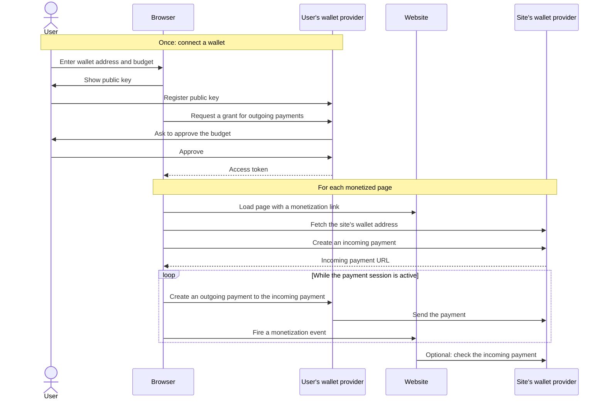

# Web Monetization Explainer

## Authors

- Michael Kohler (Interledger Foundation) <michael@interledger.org>

## Participate

- [Issue tracker and discussion](https://github.com/WICG/webmonetization/issues)
- [Specification (Editor's Draft)](https://webmonetization.org/specification/)
- [Web Monetization flows specification](https://webmonetization.org/specification/flows/)
- [Web Monetization extensions API specification](https://webmonetization.org/specification/extensions-api/)

## Table of contents

<!-- npx doctoc --github --maxlevel 3 --notitle specification/explainer.md -->
<!-- START doctoc generated TOC please keep comment here to allow auto update -->
<!-- DON'T EDIT THIS SECTION, INSTEAD RE-RUN doctoc TO UPDATE -->

- [Introduction](#introduction)
- [User-facing problem](#user-facing-problem)
  - [A user's story](#a-users-story)
  - [Goals](#goals)
  - [Non-goals](#non-goals)
- [User research](#user-research)
- [Proposed approach](#proposed-approach)
  - [How it works](#how-it-works)
  - [Dependencies on non-stable features](#dependencies-on-non-stable-features)
  - [Solving "pay sites without friction" with this approach](#solving-pay-sites-without-friction-with-this-approach)
  - [Solving "keep the user in control" with this approach](#solving-keep-the-user-in-control-with-this-approach)
  - [Solving "protect privacy" with this approach](#solving-protect-privacy-with-this-approach)
  - [Solving "work for simple sites" with this approach](#solving-work-for-simple-sites-with-this-approach)
  - [Solving "let sites respond to payments" with this approach](#solving-let-sites-respond-to-payments-with-this-approach)
  - [Solving "stay open" with this approach](#solving-stay-open-with-this-approach)
  - [Not yet specified: media and element-scoped monetization](#not-yet-specified-media-and-element-scoped-monetization)
- [Alternatives considered](#alternatives-considered)
  - [Payment Request API and Payment Handler API](#payment-request-api-and-payment-handler-api)
  - [`<meta name="monetization">` and a `document.monetization` object](#meta-namemonetization-and-a-documentmonetization-object)
  - [Payment pointers instead of URLs](#payment-pointers-instead-of-urls)
  - [Interledger STREAM directly from the browser](#interledger-stream-directly-from-the-browser)
  - [Browser extensions only, without a web standard](#browser-extensions-only-without-a-web-standard)
  - [An imperative-only API](#an-imperative-only-api)
  - [Firing events at a global object instead of the link](#firing-events-at-a-global-object-instead-of-the-link)
  - [Separate start, progress, and stop events](#separate-start-progress-and-stop-events)
  - [Integer amounts with an asset scale](#integer-amounts-with-an-asset-scale)
  - [Earlier and related approaches](#earlier-and-related-approaches)
- [Accessibility, internationalization, privacy, and security considerations](#accessibility-internationalization-privacy-and-security-considerations)
  - [Privacy](#privacy)
  - [User consent and permissions](#user-consent-and-permissions)
  - [Security](#security)
  - [Internationalization](#internationalization)
  - [Accessibility](#accessibility)
- [Stakeholder feedback / opposition](#stakeholder-feedback--opposition)
- [References and acknowledgements](#references-and-acknowledgements)

<!-- END doctoc generated TOC please keep comment here to allow auto update -->

## Introduction

Web Monetization lets a user agent send small, frequent payments from the user's
own wallet to the website they are visiting. A website declares where it accepts
payments with `<link rel="monetization" href="…">`. If the user has connected a
wallet to their browser and allows monetization for that site, the browser pays
the site while the user is on the page, without per-payment prompts. The site
gets a `monetization` event for each payment the browser starts and can use it
to change what it shows, for example by removing ads.

The browser does the work between two independent accounts: the user's wallet
and the website's wallet. Neither side needs an account with the other, and the
user's wallet provider is not told which page the user is on. Payments use
[Open Payments](https://openpayments.dev/), an open API for financial service
providers.

## User-facing problem

Most of the web is paid for by advertising, by subscriptions, or by collecting
and selling user data. Each option has costs for users:

- **Advertising** slows pages down and interrupts content. It often depends on
  tracking users across sites. Ads can also make pages harder to use with
  assistive technology.
- **Subscriptions and paywalls** suit sites that a user visits often. They work
  poorly for the long tail of sites a user visits now and then. Few people
  subscribe to a site they read once a month, and paying per article by card
  costs more in fees and effort than the article is worth.
- **Platform-specific tipping and membership services** require the user and the
  creator to join the same platform. The platform sees who pays whom, and it can
  remove a creator's ability to earn.

Users who want to support the sites they use have no simple, private, and
low-effort way to do it across the whole web. Sites that want to earn without
ads or tracking have no common way to accept such payments.

### A user's story

**Today:** A reader visits a small cooking blog a few times a month. Each visit
loads ads and third-party trackers. The reader would like to support the blog
instead. To do that, they would have to create an account on the author's
membership platform, enter card details, and commit to a monthly fee for a site
they only visit now and then. Most readers don't, so the blog keeps relying on
ads.

**With Web Monetization:** The reader connected their wallet to their browser
once and set a monthly budget. When they open the blog, the browser checks that
they allow monetization for it and sends small payments to the blog's wallet
while they read. The blog sees the payments and hides its ads. The reader can
stop paying any site at any time, and their browser can show what they paid. The
blog does not learn who the reader is or anything about their financial account.

### Goals

- **Pay sites without friction.** Once a user has connected a wallet and set a
  budget, payments to a site need no further steps per payment.
- **Keep the user in control.** The user decides whether monetization is on,
  which sites they pay, and how much they spend. They can pause or stop payments
  at any time.
- **Protect privacy.** The browser shares only what each party needs to make a
  payment. The user's wallet provider is not told which page the user visited,
  and the site does not receive the user's financial details.
- **Work for simple sites.** A static HTML page can receive payments with a
  single `<link>` element, without a backend.
- **Let sites respond to payments.** A site can learn that a payment was sent,
  check that it arrived, and offer something in return.
- **Stay open.** Any wallet provider that supports Open Payments can send or
  receive payments. There is no centralized platform that all parties must join.

### Non-goals

- **Checkout and online purchases.** Buying goods or services with explicit
  confirmation is covered by the
  [Payment Request API](https://www.w3.org/TR/payment-request/). Web
  Monetization is for small, ongoing payments.
- **Defining the payment protocol.** How wallets move money is defined by Open
  Payments, not by this proposal.
- **Defining browser UI.** This proposal does not require a specific UI for
  wallet setup, budgets, or consent. Browsers decide how to present these.
- **Deciding how much users pay.** The rate of payment is set by the user and
  the user agent, not by the website.
- **Access control or DRM.** Web Monetization tells a site that a payment was
  sent. It does not enforce access to content. Sites that gate content must
  verify payments themselves.

## User research

This section summarizes deployment experience with earlier and current
implementations of Web Monetization.

**Coil.** From 2019 until it closed in 2023, Coil sent Web Monetization payments
from its paying members to sites through its own browser extension. At the time,
sites declared a payment pointer with
`<meta name="monetization" content="$wallet.example/alice">`. Coil paid the
sites its members visited, so many sites added the tag to earn from them.
Chromium counts pages that use this tag in the top-level frame. According to
[Chrome Platform Status](https://chromestatus.com/metrics/feature/timeline/popularity/3119)
(`HTMLMetaElementMonetization`), the tag appeared on about 0.03% of page loads
in Chrome during 2021 and 2022, with a peak of about 0.048% in April 2021. In
April 2023, when Coil stopped making payments, usage fell to about 0.013%.

**The Web Monetization browser extension.** The Interledger Foundation now
maintains the
[Web Monetization browser extension](https://github.com/interledger/web-monetization-extension)
for Chrome, Firefox, Edge, and Safari. As of November 2026, the stores list
about 160 users on Chrome, about 30 on Edge, and about 17 daily users on
Firefox.
[Chrome Platform Status](https://chromestatus.com/metrics/feature/timeline/popularity/3120)
(`HTMLLinkElementMonetization`) shows `<link rel="monetization">` on about
0.00001% of page loads, with a peak of about 0.002%. Neither counter measures
payments, only pages that include the markup.

Taken together, these numbers show that sites adopt Web Monetization when users
can actually pay them. Coil's members gave sites a reason to add the tag. The
current extension has to be installed and set up separately, which limits how
many users can pay, and so how many sites have a reason to adopt the link. Built
into the browser, Web Monetization would remove that step.

## Proposed approach

### How it works

1. **The user connects a wallet.** In the browser's settings, the user enters
   the [wallet address](https://openpayments.dev/) of an account that supports
   Open Payments and sets a budget, for example a monthly amount. The browser
   generates a signing key pair and shows its public key, which the user
   registers with their wallet provider. The browser then sends the user to
   their wallet provider to approve the budget. This happens once, not per site.
   Registering the key by hand is awkward, and the group plans to let the wallet
   provider register it as part of approving the budget
   ([#799](https://github.com/WICG/webmonetization/issues/799)).
2. **A site declares a wallet address.** The site adds
   `<link rel="monetization" href="https://wallet.example/alice">`. The `href`
   is the site's wallet address, a URL that returns JSON describing the account.
   The browser fetches it in CORS mode, so the wallet provider must serve it
   with CORS headers.
3. **The browser starts a payment session.** When the link is connected to the
   document, the browser fetches the wallet address. If the fetch succeeds, the
   browser creates a _payment session_ for that link and fires a `load` event at
   the link; otherwise it fires `error`. Through Open Payments, it creates an
   _incoming payment_ at the site's wallet provider.
4. **The browser sends payments.** The browser only pays into a session while it
   is _active_: its document is fully active and every other payment session
   condition holds, for example a wallet is connected, the user has not paused
   monetization, and the user has granted permission for the site (see
   [permissions](#user-consent-and-permissions)). While the session is active,
   the browser asks the user's wallet provider to pay into the incoming payment.
   The user agent decides when to pay and how much; see
   [Budget](#solving-keep-the-user-in-control-with-this-approach).
5. **The site is notified.** For each payment the browser starts, it fires a
   `monetization` event at the `<link>` element. Its `amountSent` attribute
   holds the amount and currency, `walletAddress` the site's wallet address, and
   `incomingPayment` the URL of the incoming payment.
6. **The site can verify.** The site can query the incoming payment URL, often
   from its own server, to confirm how much it has received.



The [main specification](https://webmonetization.org/specification/) defines the
web-facing API: the link type, the event, and the integration with Permissions
Policy, CSP, and Fetch. The
[flows specification](https://webmonetization.org/specification/flows/) defines
how a browser connects a wallet and runs payment sessions with Open Payments.
The [extensions API](https://webmonetization.org/specification/extensions-api/)
lets browser extensions build management UI on top of the browser's
implementation. This explainer focuses on the web-facing API.

### Dependencies on non-stable features

- **Open Payments** is an open API maintained by the Interledger Foundation. It
  is not a W3C or IETF standard. It builds on
  [GNAP (RFC 9635)](https://www.rfc-editor.org/rfc/rfc9635) for authorization
  and on
  [HTTP Message Signatures (RFC 9421)](https://www.rfc-editor.org/rfc/rfc9421).
- **Changes to other specifications.** The specification adds the `monetization`
  link type and an exception to the `disabled` attribute in
  [HTML](https://html.spec.whatwg.org/), a `monetization` request destination in
  [Fetch](https://fetch.spec.whatwg.org/), and a `monetization-src` directive in
  [CSP](https://www.w3.org/TR/CSP3/). These are written as monkey patches today
  and would need to move into those specifications.
- **Permissions registry.** The `"monetization"` powerful feature needs to be
  registered in the
  [Permissions registry](https://w3c.github.io/permissions-registry/). See
  [User consent and permissions](#user-consent-and-permissions).

### Solving "pay sites without friction" with this approach

The user connects a wallet and approves a budget once (step 1 of
[How it works](#how-it-works)). After that, every monetized site the user allows
is paid automatically, with no prompt per payment. The site needs nothing more
than a `<link>` (see
[Work for simple sites](#solving-work-for-simple-sites-with-this-approach)).

### Solving "keep the user in control" with this approach

- **Budget.** The user sets the budget when connecting the wallet, and approves
  it at their wallet provider, which enforces it. The browser turns the budget
  into a rate of pay. In the flows specification, a monthly budget is spread
  evenly over a 30-day month of continuous time, so a user who browses monetized
  sites for a few hours a day spends only a fraction of it. The browser pays one
  session at a time, in turn, so the rate is shared across all monetized links,
  frames, and tabs and does not grow with their number.
- **Per-site permission.** The browser asks the user before paying a site the
  first time, and the user can choose a custom rate for it. See
  [User consent and permissions](#user-consent-and-permissions).
- **Pause and stop.** The user can pause monetization, for all sites or for one
  site, in the browser's settings. A paused session is no longer active, so the
  browser starts no new payments for it until the user resumes. Separately, a
  session is stopped for good when its link is removed, disabled, or changed.
  Payments already started are not canceled.

A site can check the permission state, for example to explain what Web
Monetization is before the user has decided. A custom rate the user chose is
never exposed to the site.

```js
const status = await navigator.permissions.query({ name: 'monetization' })
if (status.state === 'prompt') {
  showSupportThisSiteMessage()
}
```

### Solving "protect privacy" with this approach

- The site only sees the `monetization` event: the amount and currency sent, its
  own wallet address, and the incoming payment URL. It gets no user identifier
  or wallet details.
- The user's wallet provider is told where to pay and how much, but not the URL
  of the page.
- The `load` event on the link depends only on fetching the wallet address, not
  on whether the user has connected a wallet or granted permission, so a site
  cannot detect a wallet that way.

The remaining risks are described in [Privacy](#privacy).

### Solving "work for simple sites" with this approach

A static page receives payments with a single element, using a wallet address
hosted by its wallet provider. No script or backend is needed.

```html
<!doctype html>
<html lang="en">
  <head>
    <meta charset="utf-8" />
    <title>My Blog</title>
    <link rel="monetization" href="https://wallet.example/alice" />
  </head>
  <body>
    …
  </body>
</html>
```

A backend is useful for more advanced cases: verifying payments (see below), or
hosting the wallet address on the site's own origin as a defense against
injected wallet addresses (see [Security](#security)).

Sites that want to adapt their content can detect support:

```js
const link = document.createElement('link')
if (link.relList.supports('monetization')) {
  // Web Monetization is supported by this browser.
}
```

### Solving "let sites respond to payments" with this approach

A site can listen for the `monetization` event, for example to thank the user or
remove ads. The event bubbles, so a listener can be added to the `<link>`, the
document, or the window. The `onmonetization` event handler attribute is also
available.

```html
<link rel="monetization" href="https://wallet.example/alice" />
<script>
  window.addEventListener('monetization', (event) => {
    const { value, currency } = event.amountSent
    console.log(`The browser sent ${value} ${currency}.`)
  })
</script>
```

A `monetization` event means the browser has started a payment. It does not
prove the site received money.

```js
window.addEventListener('monetization', async (event) => {
  if (!event.isTrusted || !event.incomingPayment) return

  // Ask the site's own backend to check the incoming payment
  // at the site's wallet provider.
  const response = await fetch('/api/verify-payment', {
    method: 'POST',
    headers: { 'Content-Type': 'application/json' },
    body: JSON.stringify({ incomingPayment: event.incomingPayment })
  })
  if (response.ok) {
    unlockExclusiveContent()
  }
})
```

### Solving "stay open" with this approach

A wallet address is a plain HTTPS URL. Any provider that implements Open
Payments can host one, and the user's wallet provider and the site's wallet
provider do not need any relationship with each other.

Different parts of a page can be paid through different providers. Embedded
documents can be monetized if the embedding page allows it. The `monetization`
Permissions Policy feature has a default allowlist of `'self'`.

```html
<link rel="monetization" href="https://wallet.example/news-site" />
<iframe src="https://video.example/embed/123" allow="monetization"></iframe>
```

### Not yet specified: media and element-scoped monetization

The specification shows `<link rel="monetization">` inside `<video>`, `<audio>`,
and `<picture>` elements, so that a specific piece of media can pay a different
wallet address than the page:

```html
<video src="talk.mp4">
  <link rel="monetization" href="https://wallet.example/speaker" />
</video>
```

**This part is not fully specified and needs more discussion.**

## Alternatives considered

### Payment Request API and Payment Handler API

[Payment Request](https://www.w3.org/TR/payment-request/) is built for single
payments that the user confirms each time. An earlier Web Monetization design
modeled the sender as a
[Payment Handler](https://www.w3.org/TR/payment-handler/) that returned a stream
of payments.

- **Pros:** Reuses existing web payment APIs and their concepts.
- **Cons:** Payment Request is imperative, requires a user gesture, and shows a
  payment sheet. Web Monetization payments are small, frequent, and pre-approved
  by a budget, so a per-payment prompt would defeat the purpose.
- **Reason for rejection:** The interaction model does not fit.

### `<meta name="monetization">` and a `document.monetization` object

The first version of Web Monetization used
`<meta name="monetization" content="$wallet.example/alice">` in the document
head. A global `document.monetization` object exposed a state and fired
`monetizationstart` and `monetizationprogress` events.

- **Pros:** Easier to extend in the future.
- **Cons:** Only one wallet address per document. `<meta>` must be in the
  `<head>` and cannot be scoped to parts of a page or to embedded media. It does
  not fit Fetch, CSP, or `load`/`error` events, and a global state object adds a
  fingerprinting surface.
- **Reason for rejection:** `<link rel="monetization">` is an external resource
  link. It can be used in the body, fires `load` and `error` events, can be
  disabled, and works with CSP and Fetch.

### Payment pointers instead of URLs

Earlier versions used _payment pointers_ such as `$wallet.example/alice`, which
resolve to an HTTPS URL.

- **Pros:** Short and recognizable as a payment address.
- **Cons:** A custom syntax that the platform would have to parse and resolve.
- **Reason for rejection:** Plain HTTPS URLs need no new syntax and get Fetch,
  CORS, and CSP behavior for free.

### Interledger STREAM directly from the browser

Earlier designs had the browser send payments with the Interledger STREAM
protocol.

- **Pros:** Real-time streaming of very small amounts.
- **Cons:** Requires wallets to run Interledger connectors and expose a
  lower-level protocol. Harder to integrate with existing financial accounts.
- **Reason for rejection:** Open Payments provides a higher-level, HTTP-based
  API that wallets can implement more easily. Interledger can still be used
  between wallets.

### Browser extensions only, without a web standard

Web Monetization is available today through a browser extension.

- **Pros:** No browser changes needed. Fast to iterate.
- **Cons:** The extension needs broad host permissions to read every page, which
  is a larger privacy risk than a browser feature. Extensions cannot integrate
  with CSP, Permissions Policy, Fetch destinations, or bfcache in a consistent
  way. Each extension would need to agree on the same page API by convention.
- **Reason for rejection:** A standard gives sites one API across browsers and
  gives browsers a well-defined privacy model. The
  [extensions API](https://webmonetization.org/specification/extensions-api/)
  still lets extensions offer management UI on top of the browser's
  implementation.

### An imperative-only API

A script API such as `navigator.monetization.start(walletAddress)` could replace
the declarative link.

- **Pros:** Gives scripts full control over when payments start.
- **Cons:** Requires JavaScript. The site would decide when to start payments,
  while the user and user agent should decide.
- **Reason for rejection:** The declarative link meets the goals. Scripts can
  still add, remove, or disable links to control monetization.

### Firing events at a global object instead of the link

Earlier versions fired events at `document.monetization`.

- **Pros:** One place to listen for all payments.
- **Cons:** With several wallet addresses on a page, a global target cannot tell
  which one a payment was for.
- **Reason for rejection:** Events fire at the `<link>` element that started the
  session. They bubble, so a listener on the document or window still sees all
  payments, and `event.target` identifies the link.

### Separate start, progress, and stop events

Earlier versions had `monetizationpending`, `monetizationstart`,
`monetizationprogress`, and `monetizationstop` events, along with a `state`
property.

- **Pros:** Sites could react to each stage of a session.
- **Cons:** More API surface, and more states that reveal details about the
  user's setup.
- **Reason for rejection:** A single `monetization` event fires for each
  payment. Whether a session could be set up is already reported by the link's
  standard `load` and `error` events.

### Integer amounts with an asset scale

Earlier versions reported amounts as an integer `amount` with `assetCode` and
`assetScale`, for example `amount: "123"`, `assetScale: 2` for 1.23.

- **Pros:** Matches how ledgers store amounts.
- **Cons:** Unfamiliar to web developers, and inconsistent with existing web
  payment APIs.
- **Reason for rejection:** `amountSent` uses the same currency and decimal
  string format as `PaymentCurrencyAmount` in Payment Request.

### Earlier and related approaches

Other projects have tried to solve the same problem. They differ from Web
Monetization mainly in that they depend on one company's network or browser.

- **Google Contributor** let users pay a monthly amount to see fewer Google ads
  on participating sites. It worked only with Google's ad network and was
  [discontinued in 2017](https://en.wikipedia.org/wiki/Google_Contributor).
- **[Flattr](https://en.wikipedia.org/wiki/Flattr)** split a user's monthly
  payment among the creators they visited, as tracked by a browser extension. It
  required creators to join Flattr and has since shut down.
- **[Brave Rewards](https://brave.com/brave-rewards/)** lets users of the Brave
  browser send BAT tokens to creators who register with Brave. It is limited to
  one browser and one token.
- **Coil** (see [User research](#user-research)) required a Coil membership. Web
  Monetization now works with any Open Payments wallet instead.
- **[Payment links](https://github.com/WICG/paymentlink)** (Chromium's
  `<link rel="facilitated-payment">`, originally `rel="payment"`) use a similar
  declarative link to offer push payments for a purchase. It solves a checkout
  problem, not ongoing small payments.

## Accessibility, internationalization, privacy, and security considerations

A
[threat model](https://docs.google.com/document/d/1RqdMBZ3OECUm9UCSFacNVOFdHVQYjZhJJ9vQOvqyC4A/edit?tab=t.0#heading=h.4atdfjncmk6b)
was written in 2024 for the Chromium prototype. Parts of it no longer match the
current specification. **The threat model needs to be cross-checked and updated
against the current specification.** Where the two differ, this section follows
the specification.

### Privacy

What each party learns:

| Party                  | Learns                                                                                                      | Does not learn                                            |
| ---------------------- | ----------------------------------------------------------------------------------------------------------- | --------------------------------------------------------- |
| User's wallet provider | Amounts, timing, the site's wallet address and incoming payment, and the user's IP address                  | The URL of the page                                       |
| Site's wallet provider | That payments arrive, their amounts and timing, the user's IP address, and the browser's public signing key | The user's name or wallet address                         |
| Website                | That a payment was sent, its amount and currency, and the incoming payment URL                              | The user's identity, wallet address, or financial details |

The user's wallet provider also knows who the user is, as it holds their
account.

Known privacy risks, and how the design addresses them:

- **Inferring browsing from wallet addresses:** The user agent does not send
  page URLs to the user's wallet provider. But a wallet address often identifies
  the site's owner, so the user's wallet provider may still infer which sites
  the user pays. This risk is higher when the user's wallet provider and the
  site's wallet provider are the same company.
- **Per-visitor wallet addresses:** A site could give each visitor a unique
  wallet address and link payments to that visitor. This is no more than what
  the site could already do with first-party state.
- **Stable signing key:** The browser signs its Open Payments requests with one
  long-lived key pair, including the requests to the site's wallet provider that
  create incoming payments. A wallet provider that serves many sites can use the
  public key to link the same user across those sites. The flows specification
  notes this and may move to per-session or per-origin keys in the future.
- **Fingerprinting:** Whether `monetization` events fire reveals that the user
  has a wallet connected. The currency of `amountSent` is the currency of the
  user's wallet, which can hint at the user's country. The amount and timing can
  reveal the user's budget. If the user agent limits concurrent sessions,
  `error` events on extra links can reveal that limit.
- **Time spent on a page:** Payment timing reveals to the site's wallet provider
  how long the user is on a page. The site already knows this.

### User consent and permissions

Two mechanisms control where monetization happens:

- A **Permissions Policy feature**, `"monetization"`, lets a site allow or block
  monetization in its frames.
- A **powerful feature**, also named `"monetization"`, with
  [Permissions API](https://www.w3.org/TR/permissions/) integration, lets the
  user decide per site. Granted permission is a payment session condition: the
  browser fetches the wallet address and fires `load` regardless of the
  permission state, but only pays while the permission is granted. The user
  agent can ask the user per site, at times it chooses, or let the user allow or
  block sites in settings. A granted permission is kept until the user revokes
  it. Once revoked, the payment sessions for that origin are no longer active,
  so the browser stops paying into them. The user agent does not ask while no
  wallet is connected, so the state stays `"prompt"` both for users without a
  wallet and for users who have not decided yet.

The specification also recommends that user agents show when monetization is
possible or happening, and let the user stop or start it for a site.

### Security

- **Injected wallet addresses:** An attacker who can inject markup, for example
  through XSS or a malicious extension, could add or replace a
  `<link rel="monetization">` to redirect payments. Sites should host their
  wallet address on an origin they control and restrict wallet addresses with
  the `monetization-src` CSP directive. CSP is recommended, not required.

  ```http
  Content-Security-Policy: monetization-src https://wallet.example/
  ```

- **Embedded content:** The Permissions Policy default of `'self'` means
  cross-origin iframes cannot monetize unless the embedder allows it.
- **Spending more than the budget:** The user's wallet provider enforces the
  granted budget. Payments are made only while the document is fully active, so
  pages in the back/forward cache do not pay.
- **Background pages:** A visible but unattended page, such as a pop-under, can
  still be fully active. Whether visibility should affect sessions is an open
  question ([#657](https://github.com/WICG/webmonetization/issues/657)).
- **Fake events and replayed payments:** `MonetizationEvent` has a public
  constructor, so page script can dispatch fake events, and a modified client
  can send any incoming payment URL to the site. Sites should verify payments on
  their server, checking that the incoming payment belongs to them and that its
  `receivedAmount` has increased, before giving anything of value.
- **Credentials:** The browser's private signing key never leaves the user agent
  and is never exposed to web content. Access to the user's funds requires the
  user to approve a grant with their wallet provider.
- **Secure contexts:** `MonetizationEvent` and `MonetizationCurrencyAmount` are
  only exposed in secure contexts, and the flows specification only accepts
  HTTPS wallet addresses.

### Internationalization

- Amounts use `PaymentCurrencyAmount` from Payment Request: a currency code and
  a decimal string value. This avoids floating-point rounding and works for any
  number of decimal places.
- The `currency` of `MonetizationCurrencyAmount` defaults to an ISO 4217
  three-letter code, as in Payment Request.
- Paying in a different currency from that of the site's wallet is handled by
  the wallet providers. The flows specification currently assumes both sides use
  the same currency, and cross-currency flows are still to be defined.

### Accessibility

- Web Monetization adds no new content UI to web pages.
- Sites can use it to remove ads, which often improves the experience for people
  using assistive technology.
- Browser UI for wallet setup, consent, and status must be accessible. This is
  up to user agents.
- Sites should not make essential content depend only on payments in ways that
  leave other users with a broken page. This is a content decision, not
  something the API can enforce.

## Stakeholder feedback / opposition

- **Chromium**: No official signal. Igalia has a working prototype in Chromium
  ([Intent to Prototype](https://groups.google.com/a/chromium.org/g/blink-dev/c/4Rqw4SbjO88),
  [Chrome Platform Status](https://chromestatus.com/feature/4917148755689472))
  and is upstreaming it in small changes.
- **Gecko**: No official signal. A
  [standards position request](https://github.com/mozilla/standards-positions/issues/987)
  is open without a response.
- **WebKit**: No official signals. _TODO: Link the WebKit standards position
  request once filed._
- **Web developers**: Sites use Web Monetization today, and users pay them
  through the
  [Web Monetization browser extension](https://github.com/interledger/web-monetization-extension).

## References and acknowledgements

Related work:

- [Interledger](https://interledger.org/)
- [Open Payments](https://openpayments.dev/)
- [Payment Request API](https://www.w3.org/TR/payment-request/)
- [Web Monetization threat model (2024, needs update)](https://docs.google.com/document/d/1RqdMBZ3OECUm9UCSFacNVOFdHVQYjZhJJ9vQOvqyC4A/edit?tab=t.0#heading=h.4atdfjncmk6b)

Web Monetization builds on work by its former and current specification editors
and author.
